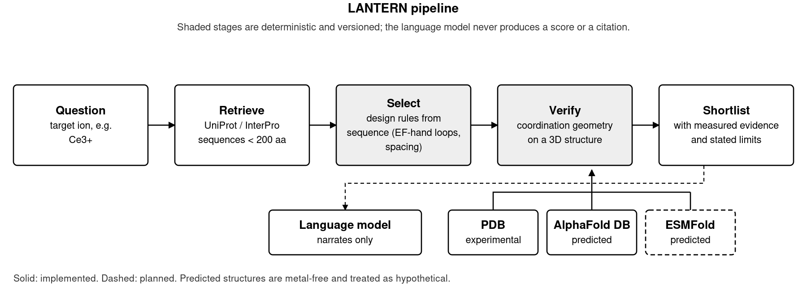

# 🧬 LANTERN

*Learning and Analysis of Nature's Tools for Element Recovery Networks*

**An evidence-aware prototype for exploring naturally occurring rare-earth-binding proteins.**

This is a *prototype*, not a validated discovery pipeline. It includes a working web UI, a fully offline demo over six authentic UniProt sequences, live sequence retrieval from UniProt and InterPro, deterministic exploratory sequence scores, first-shell coordination analysis of deposited rare-earth sites, a binding-site visualiser that draws each ion with a labelled bond to every donor it touches, and LLM-written explanations from Argonne Argo, OpenAI or Anthropic. **It does not yet compute a calibrated selectivity descriptor, experimentally grounded metal selectivity, or autonomous multi-tool planning.** See `ROADMAP.md` for the measured state of the code and the path to those.

## Pipeline at a glance



*Figure 1. The LANTERN pipeline (`docs/figures/lantern_pipeline.png`).* A typed question names the target ion; sequences are retrieved
from UniProt and InterPro, selected by stated sequence rules (EF-hand loops and spacing), and each survivor is checked against a 3D
structure (experimental from the PDB, or a predicted model from AlphaFold DB, with ESMFold planned). The shaded stages are
deterministic and versioned; the language model only narrates and never produces a score or a citation.

## Saved runs

**Every question this platform answers is kept.** Ask one on the *Ask* page and it is archived automatically; the **Saved runs** page lists them all and reopens any of them -- the proteins the design rules selected, the structures that were measured, the metal sites inside those structures, and the same 3D view of the first coordination shell the live page drew. Nothing on that page is recomputed: every number is the number that was saved when the question was answered.

Coordinates are the one thing not archived -- they are megabytes per run and already on disk under `data/structures/` -- so the viewer is rebuilt at view time by re-measuring the cached file. Where that file is gone, or no longer reproduces the sites that were saved, the view is withheld and the saved numbers are shown alone.

**[`results/runs/`](results/) is that archive, committed.** It ships seeded with all fifteen trivalent lanthanides so a fresh clone opens on a full table rather than an empty one, and [`results/README.md`](results/) is the summary GitHub renders: which deposited structure holds each ion, how it was reached, at what resolution.

Reseed with `python scripts/export_results.py`, or verify what is committed still matches the code with `--check`. A seeded run whose measurements have not changed is left on disk untouched, so a diff under `results/` is a change in what the platform claims.

## Quick start (macOS/Linux)

```bash
unzip LANTERN.zip  # If downloaded as a zip
cd LANTERN
python3 -m venv .venv
source .venv/bin/activate
pip install -r requirements.txt
cp .env.example .env
streamlit run app.py
```

Open the Streamlit URL, keep **Reference set** selected, and click **Run protein discovery**. The
reference set is six **authentic UniProt sequences** — two lanmodulins, two calcium proteins, two
negatives — screened offline with no network access. The scores are exploratory sequence heuristics
and must never be described as measured binding or selectivity. No language model is needed for any
of this.

Then open **🔬 Protein explorer**, type `9PI2`, and click **View structure**. The viewer opens on
the first rare-earth site and the **View** selector steps through the other seven. 9PI2 is the
structure to look at first: three Nd³⁺ ions at coordination number 10, each with eight carboxylate
oxygens, sitting in the same protein as a Ca²⁺ at CN 7. That gap is the entire thesis of the
project, and it is the one thing a sequence score cannot see. Those four sites appear twice in the
selector because the deposited asymmetric unit holds two copies of the chain, and the page analyses
what was deposited rather than inventing a biological assembly. The two copies are not identical:
all six Nd³⁺ read CN 10, but chain B's Ca²⁺ reads CN 5 against chain A's 7. That is the asymmetric-unit
caveat in the flesh — coordination number from a deposition is a *lower bound* — which is why every
call on this page is marked unreliable no matter which way it goes. `8FNR` (Dy), `8FNS` (Nd), `8DQ2` (La)
and `1CLL` (calmodulin, calcium only) are cached too and need no network.

## Language model configuration

The model **only narrates results**. Retrieval, screening and geometry scoring are deterministic and
never call it, so the provider you pick cannot change a number LANTERN reports — and running with no
provider at all costs you nothing but the written summary.

Pick one of three in `.env`, then switch freely in the sidebar:

```dotenv
LLM_PROVIDER=argo          # argo | openai | anthropic
LANTERN_TIMEOUT=25

# argo — Argonne gateway, needs ANL network access
ARGO_BASE_URL=https://apps.inside.anl.gov/argoapi/v1
ARGO_USER=your_anl_domain_username
ARGO_MODEL=claudeopus5              # optional; defaults to gpt56terra

# openai
OPENAI_API_KEY=sk-...
OPENAI_MODEL=gpt-4o                 # optional

# anthropic
ANTHROPIC_API_KEY=sk-ant-...
ANTHROPIC_MODEL=claude-sonnet-5-5   # optional
```

**Do not commit `.env`.** The app sends only a bounded summary of screening results, never your
credentials or full coordinates, and no error message or health badge ever echoes a key value.

`ARGO_USER` is an **ANL domain username, not a secret API key** — Argo authenticates a username.
(`ARGO_API_KEY`, the former name, is still read as a fallback.) `ARGO_MODEL` accepts either
spelling — the compact id from the Argo docs (`claudeopus5`) or the display name the gateway's own
catalogue returns (`Claude Opus 5`); both were sent live and both answered. List them with
`curl -s https://apps.inside.anl.gov/argoapi/v1/models`. The OpenAI and Anthropic keys *are* real
secrets. Argo's host is an Argonne-internal name, so access may depend on your network.

Each provider fails closed in the way it can actually fail:

| Provider | Failure this guards against |
|---|---|
| Argo | A rejected credential returns **HTTP 200 with a normal-looking completion** whose body is an access-denied notice. Detected by blocked completion id or zero billed tokens, and raised rather than displayed as analysis. |
| OpenAI | A refusal arrives as `content: null` with the reason in a sibling `refusal` field — reported as a refusal, not as an empty answer. |
| Anthropic | There is **no `system` role**; the system prompt is hoisted into the top-level `system` parameter. Forwarding it as a message would silently discard the instruction that forbids inventing affinities. |

All three disclose truncation rather than returning a summary that stops mid-caveat, and all three
raise `LLMError` on an unusable credential instead of returning prose. The sidebar badge checks the
provider answers and that your model id is one the key can reach, which is the usual reason a
previously working configuration stops working.

Start live discovery by selecting **Live database** in the sidebar. Available families:

| Topic | Route | Notes |
|---|---|---|
| `lanmodulin` | UniProt `protein_name` | The single reviewed entry, C5B164 |
| `calmodulin` | UniProt `protein_name` | Reviewed calcium comparators |
| `lanm-family` | InterPro NCBIfam NF053806 → UniProt | The 189-member lanmodulin family, 188 uncharacterized |

> **Known retrieval gap.** Neither route reaches `A0A4V2JDD3`, the *H. quercus* lanmodulin, even
> though its Dy³⁺ and La³⁺ complexes are in the PDB. It carries no lanmodulin family annotation —
> only generic EF-hand terms identical to calmodulin's — so family-label retrieval cannot see it.
> ROADMAP.md §3.7; this blocks the M4 screen and is tracked there.

`lanm-family` is a two-step retrieval because UniProt records **no** NCBIfam cross-reference for
lanmodulins — `xref:ncbifam-NF053806` returns zero hits. Membership comes from InterPro; sequences
are then fetched from UniProt by accession.

A former `ef-hand` option mapped to keyword KW-0254, which is the keyword for **Endocytosis**. It
returned 755 irrelevant proteins and has been withdrawn: no UniProt keyword denotes the EF-hand
domain.

## Project layout

```text
LANTERN/
├── app.py                        # Streamlit user experience
├── lantern/
│   ├── __init__.py
│   ├── models.py                 # Typed data records
│   ├── chemistry.py              # Unvalidated transparent sequence heuristic
│   ├── catalog.py                # Loads the authentic reference set and the test fixtures
│   ├── ions.py                   # Target-ion chemistry: the part of "which lanthanide?" that is real
│   ├── plan.py                   # Question -> typed target; falls back when no model answers
│   ├── design.py                 # The sequence rules, each one stated and individually scored
│   ├── discover.py               # The spine: plan -> select -> verify -> shortlist -> narrate
│   ├── uniprot.py                # UniProt search + InterPro family retrieval
│   ├── structure.py              # Structure fetch + first-shell coordination analysis
│   ├── alphafold.py              # Predicted models, kept separable from deposited ones
│   ├── geometry.py               # geometry-v2: the structural call, and what it refuses to score
│   ├── viewer.py                 # Binding-site scene: pure spec, then the 3Dmol serialisation
│   ├── explorer.py               # Explorer page: look at the data files directly, no model in the loop
│   ├── runs.py                   # The run archive: save, index, and rehydrate for the viewer
│   ├── history.py                # Saved runs page: browse every run, reopen any of them
│   ├── llm.py                    # Provider layer: OpenAI + Anthropic clients, and the factory
│   ├── argo.py                   # Argo chat client, fails closed on rejected credentials
│   └── agent.py                  # Fixed retrieve-then-score pipeline (not a planner)
├── scripts/
│   ├── build_reference_data.py   # Rebuild the reference set from UniProt
│   ├── build_ree_corpus.py       # Rebuild Corpus A; discovers ligand codes, never guesses them
│   ├── prefetch_structures.py    # Cache 8FNS/8FNR/8DQ2/9PI2/1CLL for an offline demo
│   ├── analyze_motifs.py         # Reproduce the ROADMAP §3.6 / §3.8 findings
│   ├── validate_motif.py         # Validate the loop pattern on 694 sequences, not six
│   ├── loop_detector.py          # Build the balanced *instrument*, vs the biased classifier
│   ├── sequence_hallmarks.py     # EF-hand period and Pro-at-2, measured through the instrument
│   ├── burial_and_charge.py      # The Dudev descriptors, and why they do not separate here
│   ├── download_corpus.py        # Fetch all 636 entries as gzipped mmCIF, resumable
│   ├── build_site_table.py       # Parse them into one 3375-site table
│   ├── corpus_descriptors.py     # Re-test the descriptors on the corpus, not on one fold
│   ├── crosscheck_metalpdb.py    # Validate the parser against an independent implementation
│   ├── matched_calcium.py        # Fetch Ca-only depositions of the same proteins, by UniProt
│   ├── paired_sites.py           # Same site, both ions: the fold-controlled contrast
│   ├── assembly_audit.py         # Which entries are parsed with half a site (ASU < assembly)
│   ├── curate_corpus.py          # Shortlist the 636 for hand-curation; never auto-labels
│   ├── selectivity_contrast.py   # Native Ln biology vs native Ca -- what actually separates
│   ├── build_ion_structures.py   # One deposited structure per lanthanide, chosen by measuring
│   └── export_results.py         # Seed the run archive offline, and write results/README.md
├── results/runs/                 # The run archive: every answered run, committed
├── results/README.md             # Its summary table, rendered by GitHub
├── data/reference_proteins.json  # 6 authentic UniProt sequences, checksummed
├── data/synthetic_examples.json  # Synthetic fixtures, used only by tests
├── data/structures/              # Prefetched coordinates + manifest
├── data/ion_structures.json      # The chosen structure per lanthanide, with every rejection
├── data/ree_pdb_entries.json     # All 636 rare-earth PDB entries, uncurated
├── data/lanthanide_sites.parquet # 3375 metal sites from those entries, with geometry
├── data/calcium_sites.parquet    # 681 Ca sites in 172 Ca-only depositions of the same proteins
├── data/calcium_counterparts.json# How those 172 were chosen, and from which accessions
├── data/assembly_counts.json     # Chains deposited vs chains in the biological assembly, per entry
├── data/curation_candidates.json # Four structured signals per entry, tiered for hand-curation
├── data/curation_verdicts.json   # The hand verdicts reached, with evidence; overrides the title pass
├── static/3Dmol-min.js           # Vendored 3dmol@2.5.5, served at /app/static; BSD-3-Clause
├── tests/                        # Offline regression tests (245, no network)
├── docs/SCIENTIFIC_CONTRACT.md   # Scientific claims and evidence gates
├── ROADMAP.md                    # Verified state, defects, milestones M0-M6
├── IMPLEMENTATION_PLAN.md        # Earlier aspirational plan, superseded in part
├── requirements.txt
├── .env.example
├── .streamlit/config.toml
└── .gitignore
```

## Run tests

```bash
pytest -q
```

## What is implemented

- Offline screening over **six authentic UniProt sequences** (two lanmodulins, two calcium proteins,
  two true negatives), each carrying an accession, a SHA-256 checksum and a retrieval date. Rebuild
  with `python scripts/build_reference_data.py`. Synthetic records are kept in a separate file used
  only by tests.
- **Offline structure demo.** `python scripts/prefetch_structures.py` caches 8FNS, 8FNR, 8DQ2,
  9PI2 and 1CLL under `data/structures/`; `fetch_structure()` reads the cache before the network.
  9PI2 is the key one: Nd³⁺ and Ca²⁺ in a single 0.99 Å crystal.
- Live retrieval for three families, including the full lanmodulin family via InterPro.
- Sequence acid fraction and limited EF-hand-like motif hints.
- Transparent, deterministic score (not metal-specific and not selectivity).
- **Two EF-loop patterns, deliberately, with the separation enforced by test.** `EF_HAND_HINT` is
  the *classifier*: it is biased on purpose, recovering 83.3% of lanthanide loops read off
  coordinates against 20.4% of 1421 curated calcium loops, and that 63-point gap is the
  discrimination. `EF_LOOP_INSTRUMENT` is the *measuring instrument*: 83.0% / 91.7%, an 8.7-point
  gap, for measuring loop properties across both families without the detector deciding the
  answer. It finds all four of calmodulin's loops where the classifier finds one. Scoring never
  uses it, and `test_scoring_never_uses_the_measuring_instrument` inspects the source to keep it
  that way — swapping it in would look like a recall improvement and would destroy the score.
  Build and validate: `python scripts/loop_detector.py`.
- Interactive result table, workflow trace, downloadable JSON.
- **Every run kept** (`lantern/runs.py`, `lantern/history.py`). Each answered question is archived
  under `results/runs/` and reopens on the **Saved runs** page with its proteins, its structures
  and its 3D sites. Runs are keyed by what was asked, not by when, so asking the same question
  twice updates one row instead of growing a second copy; a click is not a result. Saved and live
  runs go through the same code, so the archive cannot drift into a second format.
- Structure retrieval with automatic mmCIF fallback (RCSB publishes no legacy `.pdb` for large
  entries such as 6EK0, 7K00, 3J3Q); 3Dmol.js is vendored in `static/`, so the viewer needs no
  network either.
- **Binding-site visualiser** (`lantern/viewer.py`). Pick any deposited metal site and see the
  ion, a dashed bond to every first-shell donor, and the measured distance on each bond, with
  donors coloured by chemical class and toggles for residue labels, distances, waters and
  cartoon. The whole-fold view marks and names every ion for orientation. Each shape is placed
  from the coordinates `binding_neighborhood()` already measured rather than re-derived in the
  browser, so the distance on a bond is the same float the geometry-v2 table scored and the
  bond count is the coordination number by construction — a picture that cannot drift from the
  claim beneath it. Load 9PI2 for the contrast the whole project turns on: three Nd³⁺ at CN 10
  beside a Ca²⁺ at CN 7, in the same protein.
- **First-shell coordination analysis** of *experimentally deposited* rare-earth ions: O/N/S donors
  within 3.2 Å, waters included and labelled, reported as coordination number with a protein/water
  split. Verified against 8FNS (4 Nd sites, CN 9–10), 8FNR (Dy), 8DQ2 (La) and 9PI2 (Nd + Ca).
- **Donor-chemistry classification** per site — carboxylate, backbone carbonyl, side-chain amide,
  hydroxyl and water oxygens, with bidentate/monodentate and Glu/Asp splits. Bidentate carboxylate
  count separates lanthanide from calcium EF-hand sites; backbone carbonyl count does not (above).
- **Site burial and first-shell net charge**, the two descriptors the Dudev selectivity rule is
  written in — metal SASA with waters stripped, a heavy-atom count as an independent check, and
  charge counted per carboxylate *residue* rather than per oxygen. **Measured and deliberately not
  scored:** an EF-hand loop is a buried −3/−4 centre whichever ion it holds (97.6% of cached sites),
  so the rule's condition is met by 30 of 36 lanthanide sites *and 2 of 6 calcium*. Coordination
  number, already shipped, separates better than either. Measure it yourself:
  `python scripts/burial_and_charge.py`.
- **The full rare-earth structure corpus, measured.** All 636 entries parsed into
  `data/lanthanide_sites.parquet` — **3375 sites, 3116 rare-earth and 259 calcium**, 38 columns of
  geometry each. The parser is checked against MetalPDB, an independent implementation: **65 of 65
  metal ions agree on every donor it reports**, and the 26 extra donors this repo finds all lie in
  the 3.00–3.18 Å band between the two cutoffs. Two results worth knowing before using the table:
  **69.8% of lanthanide sites have two protein donors or fewer**, which is what a phasing soak
  looks like, and consequently the corpus-wide lanthanide-versus-calcium contrast *runs backwards*
  — it measures which ion was soaked in, not which the protein prefers. Build it with
  `python scripts/download_corpus.py && python scripts/build_site_table.py`, measure it with
  `python scripts/corpus_descriptors.py`.
- **The matched calcium contrast, and the two ways it can lie.** 172 Ca-only depositions of the
  same proteins, found by UniProt accession rather than by title, give **681 calcium sites** to
  compare against. Pairing them to Corpus A by *site signature* — the coordinating residues with
  the chain dropped — yields 19 same-site Ln/Ca pairs. Two traps, both measured. The first run
  capped the calcium side at 2.5 Å and not the lanthanide side, which left the Ln sites 0.17 Å
  worse-resolved (p=0.0094) and manufactured a donor-distance difference that vanished under a
  symmetric cutoff. The second is structural: a site seen with *both* ions is a site that is not
  selective, so **no natural-lanthanide-biology site has a calcium partner at all** (299 of 342
  lanthanide sites, 87.4%, have no partner) and every clean pair is a calcium protein with a
  lanthanide soaked in. Their geometry is indistinguishable
  — which does establish that a pre-formed calcium site *does not deform* when it takes a
  lanthanide. Run `python scripts/paired_sites.py --contrast data/calcium_sites.parquet`.
- **The asymmetric unit is not the site.** A metal on a crystallographic symmetry axis is
  coordinated by two protomers, but the deposited coordinates hold one — so the parse finds **half
  the coordination sphere**, and every geometric column moves at once in the direction that makes a
  real site look adventitious. For 9C8X this is CN 5→10, net charge −3→−6 and SASA 47.9→**0.00 Ų**.
  It affects **119 of 808 entries (14.7%)**: 99 in Corpus A, 20 on the calcium side. Those entries
  are now re-parsed from biological assembly 1, every row records a `coordinate_source` of `asu` or
  `assembly1`, and the correction is applied to both corpora by one rule — fixing one arm of a
  contrast and not the other is how the resolution bug above happened. Audit it with
  `python scripts/assembly_audit.py`.
- **What separates a lanthanide-selective site, measured native against native.** **Four** natural
  families — lanmodulin, the XoxF/MDH dehydrogenases, the LanD lanthanide chaperone found by the
  assembly fix, and a wild-type tandem-PepSY protein crystallised with seven different lanthanides
  — against 55 calcium accessions, both sides ≤2.5 Å and chelator-free, scored by an exact
  one-sided rank test over all C(59,4) assignments: **coordination number (9.00 vs 7.00)** is the
  only one of nine descriptors **no calcium accession reaches** (0/55, *p* = 0.000002).
  **Net charge fails for the fifth time** — it is significant (*p* = 0.00023) and it is the Dudev
  prediction, but 17 of 55 calcium accessions are as anionic, so it stays in triage; SASA fails for
  the sixth (25/55). Three statistical traps are recorded in ROADMAP §3.17 and §3.19 because each
  briefly reversed the answer: entry-level pseudo-replication (four LanD entries are one protein
  with four metals), a two-sided permutation test that scores perfect separation *worse* than
  partial separation, and a *p*-value that stays second-best of nine while its descriptor's overlap
  goes 0/55 → 30/55. The overlap count is the honest statistic at this *n*; the *p*-value is mostly
  a statement about *n*. `python scripts/selectivity_contrast.py`.
- **The fourth family cost the score a criterion** (ROADMAP §3.19). It was found by curating the
  corpus on structured metadata instead of titles (`python scripts/curate_corpus.py`) — its title
  says "Structure of MIF binding with Ytterbium ions" and names no family. It reaches **CN 9 using
  five *monodentate* carboxylates**, so the v1 criterion `bidentate ≥ 2` failed on it, and the
  threshold that keeps it (`≥ 1`) admits **30 of the 55 calcium accessions**. Dropping the
  criterion cost 2 false-positive sites out of 664 and bought back 12 points of sensitivity and a
  whole family. The hand-curation verdicts behind this, with their evidence, are in
  `data/curation_verdicts.json`; the evidence admitting an entry to the positive class is
  deliberately non-geometric, since geometry is what the contrast then measures on it.
- **`geometry-v2`, the structural call** (`lantern/geometry.py`, shown in the Structure tab).
  One criterion: **coordination number ≥ 9**, at the weakest of the four lanthanide families.
  **There are no weights and now only one number**, because a weighted sum fitted on four families
  would be four numbers fitted to four points. It reproduces the separation it came from (4/4 Ln
  families pass, **0/55 Ca accessions**, and **0 of 28** surviving sites in the Tb-Xo4
  crystallophore series — a second negative control with the right element and no biology), and on
  9PI2 — Nd³⁺ and Ca²⁺ in one 0.99 Å crystal, so fold and resolution are held identical — it calls
  all **6 Nd sites** lanthanide-like and both **Ca sites** calcium-like. Site-level calibration,
  pseudo-replicated and quoted as such: 65.4% sensitivity, 99.25% specificity. It **refuses** to
  score chelated sites and anything worse than 2.5 Å, and marks a *negative* call made on an
  asymmetric unit as unreliable — coordination number is a count a truncated parse can only
  understate. Bidentate carboxylates, net charge and SASA are reported next to every call and
  never scored.
- **What the score is, out of sample.** Applied to the 98 sites of the six shortlisted entries that
  belong to no family, v2 fires exactly once: on Lu³⁺ sitting in EcoRV's catalytic Mg²⁺ site
  (5F8A), coordinated by the enzyme's own `GLU45;ASP74`. That is a genuine lanthanide-suited site
  in a protein that never evolved to meet one — **v2 ranks sites, not organisms**, so the curation
  label is carried beside the call rather than folded into it. The same six entries are what shows
  the chelator refusal is load-bearing: 4IRW's Tb–dipicolinate cage produces **8 sites at CN ≥ 9
  with zero protein donors**, and the filter removes all of them.
- **How far "no fifth family" reaches, measured rather than asserted.** That claim rested on having
  read every shortlisted entry — which says nothing about entries the shortlist never proposed. The
  shortlist keys on depositor vocabulary and `geometry-v2` keys on coordination geometry, so the
  two can audit each other: of 1667 scoreable lanthanide sites, 174 reach CN ≥ 9 and **81 of them,
  in 38 entries, were tiered "not worth reading"**. None looks like natural lanthanide biology, so
  the conclusion holds — but it now rests on two independent probes instead of one shortlist, and
  reading those 38 is the next curation step. `scripts/curate_corpus.py` prints the audit; the
  counts are pinned by tests so that improving recall forces the number to be restated.
- Text explanations constrained to screening output, from Argo, OpenAI or Anthropic, with unusable credentials failing closed on all three.

## Measured baseline

Coordination descriptors computed by this repo on real structures:

| Structure | Ion | CN | Protein donors | Waters | Bidentate carboxylates |
|---|---|---:|---:|---:|---:|
| 8DQ2 lanmodulin | La³⁺ (×12) | 10 | 10 | 0 | 4 |
| 8FNS lanmodulin | Nd³⁺ (×3) | 9 | 7 | 2 | 2 |
| 8FNS lanmodulin | Nd³⁺ (site 204) | 10 | 8 | 2 | 3 |
| 8FNR lanmodulin | Dy³⁺ (biological) | 9 | 9 | 0 | 3 |
| 1CLL calmodulin | Ca²⁺ (×4) | 7 | 6 | 1 | 1 |

This is the discriminating signal: biological lanthanide sites sit at CN 9–10, calcium sites at
CN 7. **Acidic-residue content, which the sequence score measures, is identical between them** —
which is why the score is labelled triage-only throughout the UI.

Sharper still, inside a single structure. All four Dy³⁺ sites of 8FNR chain A:

| Site | Donor residues | CN | Waters |
|---|---|---:|---:|
| EF1 | 34, 36, 38, 40, 42, 45 | **9** | 0 |
| EF2 | 58, 60, 62, 64, 66, 69 | **9** | 0 |
| EF3 | 83, 85, 87, 89, 91, 94 | **9** | 0 |
| EF4 | 107, 109, 111, 113, 118 | **7** | 1 |

One protein, one metal, one crystal — and coordination number still separates the three genuine
lanthanide sites from the one that behaves like a calcium site.

**Sharpest of all: 9PI2**, *A. lacus* lanmodulin at 0.99 Å, which resolves Nd³⁺ **and** Ca²⁺ in the
same crystal — the cleanest internal control this project could ask for, since every variable
except the ion is held fixed:

| Chain A site | Ion | CN | Protein donors | Waters | Bidentate carboxylates |
|---|---|---:|---:|---:|---:|
| 201, 202, 203 | **Nd³⁺** | **10** | 10 | **0** | **4** |
| 204 | **Ca²⁺** | **7** | 6 | **1** | **1** |

One crystal, one protein, two ions, and the split is total. The 0.99 Å resolution means this is
measured, not modelled.

> **A negative result worth more than the positives.** Across all **42** metal sites in the five
> cached structures — three lanthanide elements and calcium, CN 4 to 10 — the backbone-carbonyl
> donor count is **exactly 1, every time**. In a PDB-wide survey, carboxylate-vs-backbone-carbonyl
> ratio is the single strongest Ln/Ca discriminator (p = 1.6×10⁻⁴¹). *Inside the EF-hand family it
> carries zero information*, because the loop grammar fixes position 7 as a backbone carbonyl
> regardless of which ion binds. Features for M3 must be selected against calcium **EF-hand**
> proteins, not against all calcium sites, or they will encode the fold and not the ion.
> ROADMAP.md §3.9.

### The sequence score used to invert. It no longer does.

Until 2026-10-19 this section reported a defect: *Lanmodulin, H. quercus* (A0A4V2JDD3) — a
structurally confirmed Dy³⁺ binder — scored **zero** EF-hand motifs and ranked **below both calcium
proteins**, at 35.1. The ranking is pinned by test precisely so that fixing it would be a visible
event rather than a quiet one. Here is the event.

| Protein | Role | Score | Motifs | |
|---|---|---:|---:|---|
| Lanmodulin, *M. extorquens* (C5B164) | **lanthanide binder** | 86.7 | 4 | ↑ from 74.7 / 3 |
| Lanmodulin, *H. quercus* (A0A4V2JDD3) | **lanthanide binder** | **71.1** | **3** | ↑ from 35.1 / 0 |
| Troponin C, human (P02585) | calcium protein | 69.0 | 2 | — |
| Calmodulin-1, human (P0DP23) | calcium protein | 57.0 | 1 | — |
| Haemoglobin α (P69905) | true negative | 23.4 | 0 | — |
| Chymotrypsinogen A (P00766) | true negative | 19.1 | 0 | — |

The cause of the inversion was that the EF-hand regex encoded the **calcium** consensus: it demanded
Asp at loop position 1 and Gly at position 6. Reading resolved coordinates in 8FNR, 8DQ2 and 9PI2
shows both demands are wrong for lanthanide loops — Asn Oδ1 at position 1 is a genuine first-shell
donor, and Gly at 6 is a backbone-flexibility requirement of the 7-coordinate *calcium* geometry,
not a donor at all. Relaxing exactly those two positions makes the three Dy³⁺ loops visible.

**The fix is not a tuning exercise, and three things keep it honest:**

1. **The discriminating constraint was inherited, not added.** Position 9's `[DE]` was already in
   the calcium consensus and was left untouched. It turns out to be the position doing the work:
   a carboxylate sits at position 9 in **82.6%** of lanmodulin loops versus **39.7%** of calcium
   EF-hand loops. Position 9 is now reported as a named feature (`Candidate.position_9`) rather
   than left buried in the regex — but deliberately *not* added to the score, since the loops that
   matched already required it and scoring it twice would double-count.

   > **The obvious reading of the structures is wrong here, so it is worth stating plainly.** In
   > every structure that reaches CN 10 the position-9 residue is **Glu** — bidentate, water
   > expelled — which makes Glu-at-9 look like the lanthanide marker. Across the family it is the
   > reverse: Glu at 9 appears in **0.5%** of lanmodulin loops and **13.3%** of calcium EF-hand
   > loops, 27× enriched in the wrong direction. **Asp carries the signal** (82.1% vs 26.4%). Glu
   > at 9 marks a rare sub-architecture — which happens to include this project's best structural
   > control, A0A4V2JDD3. Both facts are true; they are about different things.
2. **It was validated before it shipped, on 694 sequences, not six.** Against 505 reviewed calcium
   EF-hand proteins, sensitivity for the 189-member lanmodulin family rises **91.0% → 96.8%** while
   specificity holds at ~91% (balanced accuracy 91.0% → 93.9%), and the share of family members
   scoring zero motifs falls from 1.1% to **0.0%**. Reproduce: `python scripts/validate_motif.py`.
3. **It still discriminates.** A0A4V2JDD3 scores **3** motifs, not 4 — the pattern finds its three
   genuine lanthanide loops and correctly skips EF4, which is CN 7 with a bound water and behaves
   like a calcium site. Calmodulin, with four EF-hands, still scores 1.

**What this does *not* mean.** A0A4V2JDD3 clears troponin C by **2.1 points on a 100-point scale** —
one motif's worth of nothing. The ordering is now right; the margin is not evidence of a calibrated
descriptor, and `test_the_separation_is_thin_and_the_test_says_so` pins it as thin on purpose. A
motif count is a triage filter, not an affinity. M3 remains open. Full analysis in ROADMAP.md
§3.6–§3.9.

## What remains for a credible discovery claim

- ~~Verified real positive/negative reference sequences~~ — done; see *Measured baseline*.
- ~~A motif descriptor derived from lanthanide structures rather than a calcium consensus~~ —
  done, and validated on 694 sequences; see *The sequence score used to invert*. It is a triage
  filter, not a calibrated descriptor, so M3 remains open.
- Retrieval that does not depend on family labels (still blocks the headline screen — see the
  known retrieval gap above).
- Experimental protein–metal binding constants. Note the ceiling: matched-condition Kd values for
  both a lanthanide **and** Ca²⁺ on the same construct exist for only **four** proteins, so this is
  a validation set, never a training set.
- PDB↔UniProt residue mapping and accessible metal-site detection for structures without deposited ions.
- A curated corpus of all 636 rare-earth PDB entries, classified by site provenance.
- A calibrated geometric descriptor replacing the sequence heuristic for ranking.
- Sequence homology and redundancy controls; hold-out evaluation.
- A planner with bounded dynamic tool selection, provenance and source citation aggregation.
- Robust security, UI and automated integration tests.

**Read `ROADMAP.md`** for the verified state of the code, the nine defects found by measurement,
the three finite corpora the project actually spans, and milestones M0–M6. `IMPLEMENTATION_PLAN.md`
is the earlier aspirational plan, retained for reference; `ROADMAP.md` §7 lists which parts of it
evidence has since contradicted.
